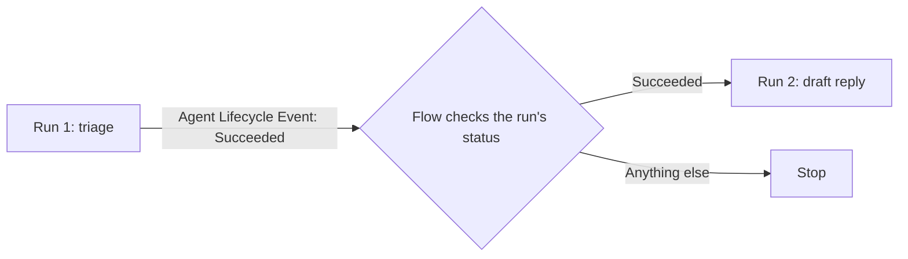

Core has no pipeline object. To run agents one after another, a Flow listens for one run to finish and starts the next. Core owns each run. Flow owns the order.

## Build the chain

1. Create a platform event-triggered Flow on **Agent Lifecycle Event** (`AgentLifecycleEvent__e`).
2. Add a Decision: `Transition__c` equals `Succeeded` and `DefinitionId__c` equals the first agent's Agent Definition Id.
3. Add **Get Agent Run Result** with Run ID set to `RunId__c`. Add a Decision that continues only when **Status** is `Succeeded`. The event is a hint. The run's own status is the proof.
4. Add **Start Agent Run** for the next agent:

   | Input | Value |
   | --- | --- |
   | Parent Run ID | `{!$Record.RunId__c}` |
   | Correlation Key | `{!$Record.RunId__c}-draft` |
   | Anchor Record ID | The same record as the first run |
   | Input | What the next agent should do. Pass record Ids, not values. |

5. Set the user the Flow runs as. Give that user `AgentKernelRunAgents`, a share of the next agent, and use of its identity's Named Credential.

Pass Ids, not values, because a run's sensitive values are tokens that work only inside that run.

## Questions

| Question | Answer |
| --- | --- |
| Whose access does the next run get? | If the first run was limited to a person, the next run keeps that limit, whoever starts it. Otherwise the execution user's access. |
| What if a step fails? | The chain stops. Rescue the failed run. When it succeeds, the Flow starts the next step. |
| What if the event is lost? | Lifecycle events are best effort. The run story shows a parent with no child. Start the next run again with the same Correlation Key. |
| What does a chain cost? | Each step is a full run: about 2 jobs and 1 API call to start, plus its model and tool steps. Use chains for background work, not for a person waiting on a page. |
