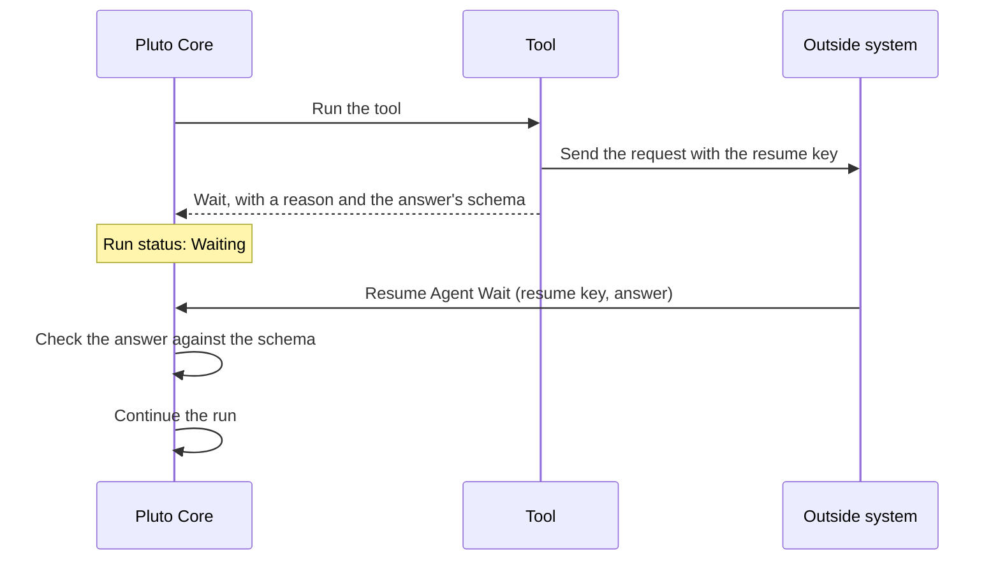

Some systems answer later, for example a credit check that takes hours. A tool can make the run wait for that answer instead of holding a job open.

## How it works

1. A developer writes a tool that sends the request and returns "waiting", with a reason such as "Waiting for the credit check result" and a JSON Schema for the answer. See the [extension contract](/extend/contract/).
2. The tool gives the outside system the call's **resume key**.
3. The run waits. Its status is **Waiting**, and the run story shows the reason and when the wait expires.
4. When the outside system has the answer, it calls the **Resume Agent Wait** Flow action, or `AgentRunService.resumeWait` in Apex, with the resume key and the answer as JSON.
5. Core checks the answer against the schema and continues the run. The agent reads the answer as the tool's result.

## The resume key

:::caution
Treat the resume key as a secret. Never log it or show it.
:::

- The key is the only authority the caller needs. It does not need any Pluto permission set.
- It works only for this one wait.
- Rotating the trust key makes the keys of open waits stop working.
- On a run of an agent without an Agent Execution Identity, only the person who started the run can resume it.

## When the answer never comes

The tool sets how long the run waits. When the time passes, the recovery schedule marks the tool call failed and pauses the run with `WAIT_EXPIRED`. An operator can then rescue the run, so the agent continues without the answer, or cancel it. An operator can also cancel a waiting run at any time. See [Fix a stuck run](/operate/stuck-run/).
