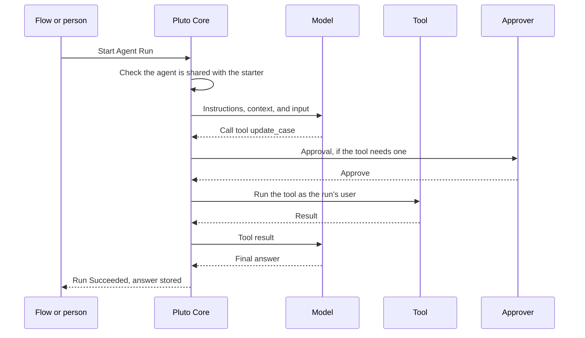
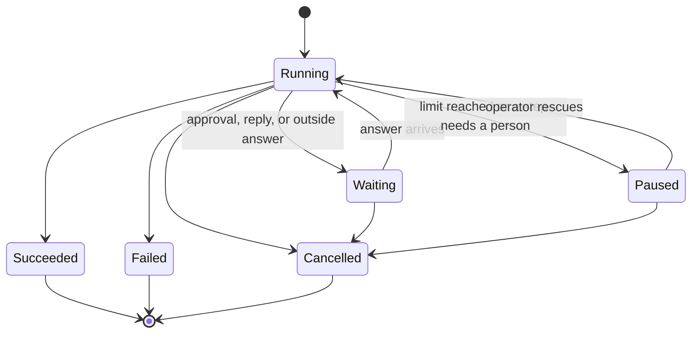

A run is one piece of work by one agent. A Flow, Apex, or a person on a record page starts it. Pluto Core then calls the model, runs the tools the model asks for, and stores every step on the run.

## The steps

Each model turn runs in its own Queueable job. A tool call whose tool type is **Stays in This Org** runs in the same job as the model turn or **Reads Outside Systems** call before it. Every other tool call gets a job of its own. If a job fails or the org restarts it, Core's recovery schedule picks the run up again within about 10 minutes. A step can run twice without doing its work twice.

## Who the run acts as

The agent's **Agent Execution Identity** decides this.

| Agent Execution Identity | The run acts as | Can wait for approval? | Can run from a schedule? |
| --- | --- | --- | --- |
| Set | The identity's execution user, a dedicated Salesforce user. A run a person starts is also limited to what that person can see. | Yes | Yes |
| Blank | Whoever starts the run. | No | No |

Use an identity for approvals, background work, and runs that must survive a long wait. Leave it blank for a simple helper that only does what the signed-in person could do anyway. See [Create an execution identity](/setup/execution-identity/).

## Run states

| Status | What it means | What you do |
| --- | --- | --- |
| Running | A step is running or queued. | Nothing. |
| Waiting | The run waits for an approval, a person's reply, or an outside system. It ends on its own when the wait expires. | Nothing, or cancel it. |
| Paused | The run stopped and needs a person. The error code says why. | See [Fix a stuck run](/operate/stuck-run/). |
| Succeeded | The agent gave its final answer. | Read the answer. |
| Failed | The run could not finish. | Read the error, fix the cause, start a new run. |
| Cancelled | A person or the system cancelled it. | Nothing. |

## What a run keeps

Every run stores its input, each model request and reply, each tool call with its input and result, each approval, and its final answer. Sensitive values are stored as tokens. The data is cleared after the retention period, 30 days by default. See [Retention and erasure](/data/retention/).
